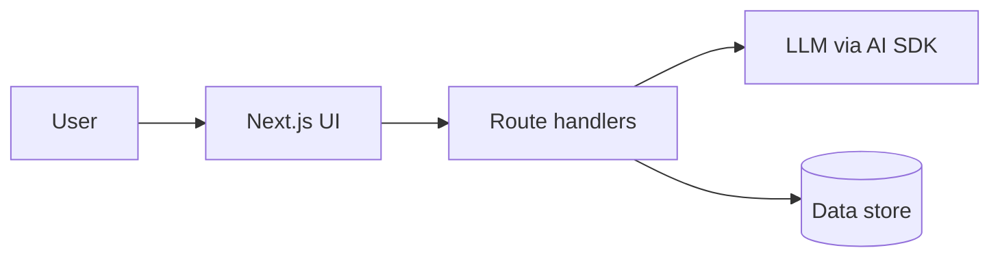

# Plan

_Derived from `BRIEF.md`._

## Requirements checklist (quoted from the brief)
- [ ] R1: "..."
- [ ] R2: "..."

## Assumptions / open questions
- 

## MVP scope
- 

## Stretch goals (only if the MVP is deployed and solid)
- 

## Architecture

## Timeline
| Block | Goal |
|---|---|
| Hour 0-1 | Scaffold + first deploy to Vercel |
| ... | |
| Before sending | Definition-of-done checklist in CLAUDE.md |
