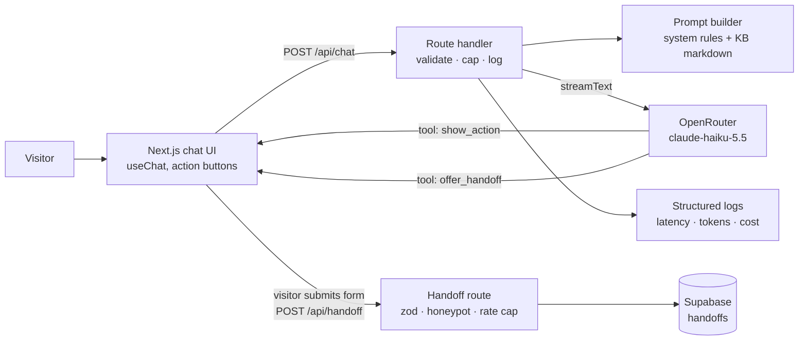

# plan.md: Cadre AI Support Chatbot

Source of truth for scope and sequencing, derived from [`docs/BRIEF.md`](docs/BRIEF.md). Each phase ends with a working production deploy and a commit. Phases run in order, and work inside a phase can be parallelized with subagents.

## 1. Requirements checklist (quoted from the brief)
| # | Requirement | Phase | Status |
|---|---|---|---|
| R1 | "a functional chatbot that a prospective or existing Cadre AI client could plausibly use to get answers" | 1 | [x] |
| R2 | "A prospective client asking what Cadre AI does and whether we work with their industry" | 2 | [x] |
| R3 | "Someone asking how to book a call with an AI strategist" | 3 | [x] |
| R4 | "A client asking how to access the Cadre portal to track their AI tools, agents, and results" | 2–3 | [x] |
| R5 | "A business leader asking what the AI Maturity Index is and how to get scored" | 2–3 | [x] |
| R6 | "Someone asking about Cadre's approach to LLM selection and data security" | 2 | [x] |
| R7 | "A user asking a question the bot can't answer — and needs to escalate or redirect" | 3 | [x] redirect via actions, plus a consented handoff form saved to Supabase (D4, D10) |
| R8 | "A deployed, publicly accessible URL" | 0 | [x] |
| R9 | "A CLAUDE.md at the root" / "A plan.md at the root" | 0 | [x] |
| R10 | Zip of the project including `.git`, excluding dependency folders | 6 | [x] built from a fresh `git clone`, so only tracked files ship |
| R11 | Chatbot LLM runs through the provided OpenRouter key ($5 budget) | 0 | [x] |

## 2. Product decisions (what the bot knows, and where it draws the line)
- **Audience:** prospects (what Cadre does, fit, how to start), existing clients (portal access and support routing), and the curious (Maturity Index, approach, security).
- **Knowledge:** a curated, hand-reviewed knowledge base built from Cadre's public website. Every fact carries a source URL. The bot answers **only** from the KB. Anything outside it is redirected or escalated, never guessed.
- **Hard lines (always escalate or redirect):**
  - Pricing quotes. The bot explains engagement shape if the KB covers it, but gives no numbers.
  - Anything about a specific client's account or data. The bot can't see it and routes to the portal or account team.
  - Legal and contract questions, and security questionnaires beyond published claims.
  - Off-topic requests and attempts to override instructions are politely refused.
- **Links are deterministic:** the bot never writes URLs, emails or phone numbers itself. It picks an action from a fixed enum (`src/lib/actions.ts`), and the UI renders a button whose URL comes from config. That rules out hallucinated links.
  - Research showed there is no public calendar, so `book_call` opens the chat's own strategist form (D19), falling back to `cadre.ai/contact`.
  - `maturity_index` opens `portal.gocadre.ai/ai-maturity-index`; `client_portal` opens `portal.gocadre.ai`; `case_studies` opens `cadre.ai/case-studies`.
  - `email_team` and `call_team` use the `CONTACTS` values, which code also fills into reply text via `[[contact:id]]` markers (D21).
  - Facts cite their source page inline with `[[src:id]]` markers, mapped to URLs in `src/lib/sources.ts` (D18).
- **Escalation is a structured handoff:** the bot tags the topic and writes a one-line summary, and the visitor fills in a form matching Cadre's contact form (first and last name, email, company, optional phone and note; D10). The submission is validated with zod and saved to Supabase, so the inbound team gets a real lead instead of a dead end. *(Changed during Phase 3: the original plan had the bot collect contact details in chat. See D4 for why the form is better.)*

## 3. Assumptions and open questions
- Gaps the public site doesn't cover all become handoff topics, not guesses:
  - pricing
  - how portal access is granted
  - how the Maturity Index is scored
  - Cadre's own certifications (SOC 2, DPA)
  - support response times
- The handoff store is Supabase, provisioned through the Vercel Marketplace on the project's own Vercel team, so env vars are injected automatically.
- There is no auth. Every visitor is anonymous, and "existing client" support is limited to routing.
- The $5 budget has to cover development, evals and public traffic, so we cap tokens per turn, cap history length, and rate limit.

## 4. Scope
**MVP (must ship):**
1. A streaming chat UI with suggested starter questions, a clear "AI assistant" label and error states.
2. `/api/chat` with a system prompt and the KB, running Claude Haiku 5.5 via OpenRouter.
3. A curated KB covering R2–R6, with sources.
4. Action buttons (deterministic links) and a structured handoff saved to Supabase.
5. Guardrails: input length cap, history cap, max output tokens, refusal behaviour, and graceful timeout and error UI.
6. An eval set of about 15–20 cases covering every scenario, the hard lines and injection attempts, with results recorded.
7. Structured logs per request: latency, tokens, cost, model, and tool calls.

**Stretch (only after the MVP is deployed and evals pass):** none shipped. Post-MVP time went into Phase 7 (fixes found by testing prod transcripts) instead. Each item is covered in "Next steps & scaling" in `docs/DECISIONS.md`.
- An `/admin` inbox listing handoffs, protected by a simple password.
- A Slack or email notification when a handoff is created.
- Persisted conversation analytics: top intents and the escalation rate.
- Running the eval set across 2–3 models to compare quality and cost.
- An embeddable widget (`<script>`) for cadre.ai.

**Out of scope (intentionally):** user accounts or real portal integration, RAG/vector search (the corpus is small enough to fit in context), multilingual support, voice, and CRM integration. Each is covered under "Next steps" in `docs/DECISIONS.md`.

## 5. Architecture

- `src/lib/ai.ts`: model config (OpenRouter provider and model IDs). Changing models is a one-line change.
- `src/prompts/`: the system prompt, with comments explaining each rule.
- `knowledge/*.md`: KB files with source URLs, read once per server instance and cached (`src/lib/knowledge.ts`).
- `src/lib/actions.ts`: the action enum and URL map, plus `CONTACTS` (deterministic). `src/lib/sources.ts`: citation ids → URLs.
- `src/lib/handoff.ts`: the zod schemas, shared with the browser. `src/lib/handoff-store.ts`: the server-only Supabase insert.
- **Data model:** `handoffs(id, created_at, status, topic, summary, name, first_name, last_name, email, phone, company, note, transcript, ip_hash)`. `name` holds "first last" for older readers. See `supabase/migrations/`.

## 6. Phases
| Phase | Goal | Done when |
|---|---|---|
| 0 ✅ | Plan, CLAUDE.md, OpenRouter wiring, health check | `/api/health/ai` is green on prod using the OpenRouter key |
| 1 ✅ | Chat skeleton: streaming UI and `/api/chat`. Action buttons (`show_action`) were pulled forward from Phase 3 because the UI contract needed them | A prod user can chat |
| 2 ✅ | Knowledge base (subagent research; human fact-check done Oct 15), plus the system prompt | R2, R4–R6 answered from the KB, with sources |
| 3 ✅ | Structured handoff to Supabase (action buttons already shipped in Phase 1). Verified on prod: offer → form → row saved, public key denied | R3, R7 work end to end on prod |
| 4 ✅ | Guardrails and failure states: edge rate limit (D8), handoff cap, timeout → retryable error, 429 message, prompt caching (D7). Verified on prod: 429 after 20 POSTs/min | Bad input, timeouts and refusals are handled in the UI |
| 5 ✅ | Evals: 20 cases at the end of this phase (handoff expectations added in Phase 3), 20/20; a full run costs about $0.006 with caching | `npm run eval` passes; results in `docs/DECISIONS.md` |
| 6 ✅ | Docs, README, final checks, submission zip (fresh clone including `.git`) | Definition of done in CLAUDE.md is met |
| 7 ✅ | (Added after Phase 6 shipped.) Iteration from prod transcripts (D9–D22): lead-form handoff, inline citations, in-chat strategist form, one follow-up question for discovery, contact details filled by code. Prompt fixes added eval cases: 34 cases, last full run 32/34 (`everything-in-detail` runs over the length limit, a known miss; `off-topic` passed 4/4 on reruns) | Each change has a decision record; prompt changes have eval cases |
| 8 | Answer chips for the discovery question (D23): tappable answers drawn from the KB, industry first, typing still open. 35 eval cases, last full run 33/35 (misses explained in the eval log) | Chips tested locally; evals pass or misses are explained |
