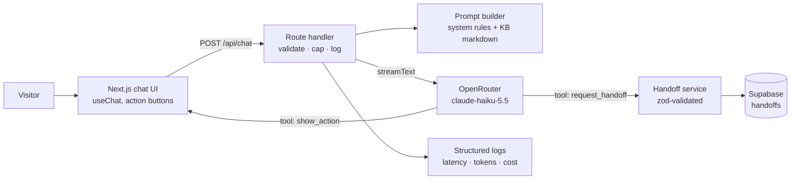

# plan.md: Cadre AI Support Chatbot

Source of truth for scope and sequencing, derived from [`docs/BRIEF.md`](docs/BRIEF.md). Each phase ends with a working production deploy and a commit. Phases run in order, and work inside a phase can be parallelized with subagents.

## 1. Requirements checklist (quoted from the brief)
| # | Requirement | Phase | Status |
|---|---|---|---|
| R1 | "a functional chatbot that a prospective or existing Cadre AI client could plausibly use to get answers" | 1 | [x] |
| R2 | "A prospective client asking what Cadre AI does and whether we work with their industry" | 2 | [x] |
| R3 | "Someone asking how to book a call with an AI strategist" | 3 | [x] |
| R4 | "A client asking how to access the Cadre portal to track their AI tools, agents, and results" | 2–3 | [x] |
| R5 | "A business leader asking what the AI Maturity Index is and how to get scored" | 2–3 | [x] |
| R6 | "Someone asking about Cadre's approach to LLM selection and data security" | 2 | [x] |
| R7 | "A user asking a question the bot can't answer — and needs to escalate or redirect" | 3 | [~] redirect works; handoff in Phase 3 |
| R8 | "A deployed, publicly accessible URL" | 0 | [x] |
| R9 | "A CLAUDE.md at the root" / "A plan.md at the root" | 0 | [x] |
| R10 | Zip of the project including `.git`, excluding dependency folders | 6 | [ ] |
| R11 | Chatbot LLM runs through the provided OpenRouter key ($5 budget) | 0 | [x] |

## 2. Product decisions (what the bot knows, and where it draws the line)
- **Audience:** prospects (what Cadre does, fit, how to start), existing clients (portal access and support routing), and the curious (Maturity Index, approach, security).
- **Knowledge:** a curated, hand-reviewed knowledge base built from Cadre's public website. Every fact carries a source URL. The bot answers **only** from the KB. Anything outside it is redirected or escalated, never guessed.
- **Hard lines (always escalate or redirect):**
  - Pricing quotes. The bot explains engagement shape if the KB covers it, but gives no numbers.
  - Anything about a specific client's account or data. The bot can't see it and routes to the portal or account team.
  - Legal and contract questions, and security questionnaires beyond published claims.
  - Off-topic requests and attempts to override instructions are politely refused.
- **Links are deterministic:** the bot never writes URLs itself. It picks an action from a fixed enum, and the UI renders a button whose URL comes from config. That rules out hallucinated links.
  - Research showed there is no public calendar. Every "Talk to an AI Strategist" CTA goes to the contact form, so `book_call` opens `cadre.ai/contact`.
  - `maturity_index` opens `portal.gocadre.ai/ai-maturity-index`.
  - `client_portal` opens `portal.gocadre.ai`.
  - `email_team` opens `hello@gocadre.ai`.
- **Escalation is a structured handoff:** with the user's consent, the bot collects name, email and company, and writes a summary. A tool call validates it with zod and saves it to Supabase, so the inbound team gets a real lead instead of a dead end.

## 3. Assumptions and open questions
- Gaps the public site doesn't cover all become handoff topics, not guesses:
  - pricing
  - how portal access is granted
  - how the Maturity Index is scored
  - Cadre's own certifications (SOC 2, DPA)
  - support response times
- The handoff store is Supabase, provisioned through the Vercel Marketplace on the project's own Vercel team, so env vars are injected automatically.
- There is no auth. Every visitor is anonymous, and "existing client" support is limited to routing.
- The $5 budget has to cover development, evals and public traffic, so we cap tokens per turn, cap history length, and rate limit.

## 4. Scope
**MVP (must ship):**
1. A streaming chat UI with suggested starter questions, a clear "AI assistant" label and error states.
2. `/api/chat` with a system prompt and the KB, running Claude Haiku 5.5 via OpenRouter.
3. A curated KB covering R2–R6, with sources.
4. Action buttons (deterministic links) and a structured handoff saved to Supabase.
5. Guardrails: input length cap, history cap, max output tokens, refusal behaviour, and graceful timeout and error UI.
6. An eval set of about 15–20 cases covering every scenario, the hard lines and injection attempts, with results recorded.
7. Structured logs per request: latency, tokens, cost, model, and tool calls.

**Stretch (only after the MVP is deployed and evals pass):**
- An `/admin` inbox listing handoffs, protected by a simple password.
- A Slack or email notification when a handoff is created.
- Persisted conversation analytics: top intents and the escalation rate.
- Running the eval set across 2–3 models to compare quality and cost.
- An embeddable widget (`<script>`) for cadre.ai.

**Out of scope (intentionally):** user accounts or real portal integration, RAG/vector search (the corpus is small enough to fit in context), multilingual support, voice, and CRM integration. Each is covered under "Next steps" in `docs/DECISIONS.md`.

## 5. Architecture

- `src/lib/ai.ts`: model config (OpenRouter provider and model IDs). Changing models is a one-line change.
- `src/prompts/`: the system prompt, with comments explaining each rule.
- `knowledge/*.md`: KB files with source URLs, loaded into the prompt at build time.
- `src/lib/actions.ts`: the action enum and URL map (deterministic).
- `src/lib/handoff.ts`: the zod schema and Supabase insert.
- **Data model:** `handoffs(id, created_at, name, email, company, topic, summary, transcript_excerpt, status)`.

## 6. Phases
| Phase | Goal | Done when |
|---|---|---|
| 0 | Plan, CLAUDE.md, OpenRouter wiring, health check | `/api/health/ai` is green on prod using the OpenRouter key |
| 1 ✅ | Chat skeleton: streaming UI and `/api/chat`. Action buttons (`show_action`) were pulled forward from Phase 3 because the UI contract needed them | A prod user can chat |
| 2 ✅ | Knowledge base (subagent research; human fact-check pending), plus the system prompt | R2, R4–R6 answered from the KB, with sources |
| 3 | Structured handoff to Supabase (action buttons already shipped in Phase 1) | R3, R7 work end to end on prod |
| 4 | Guardrails and failure states | Bad input, timeouts and refusals are handled in the UI |
| 5 (started) | Evals: 18 cases, all passing on the first run; they keep running in every later phase | `npm run eval` passes; results in `docs/DECISIONS.md` |
| 6 | Docs, README, final checks, submission zip (fresh clone including `.git`) | Definition of done in CLAUDE.md is met |
